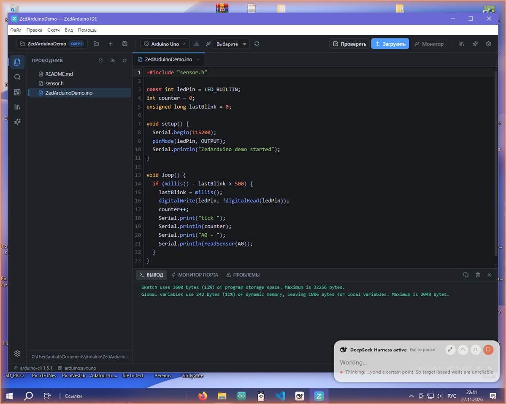
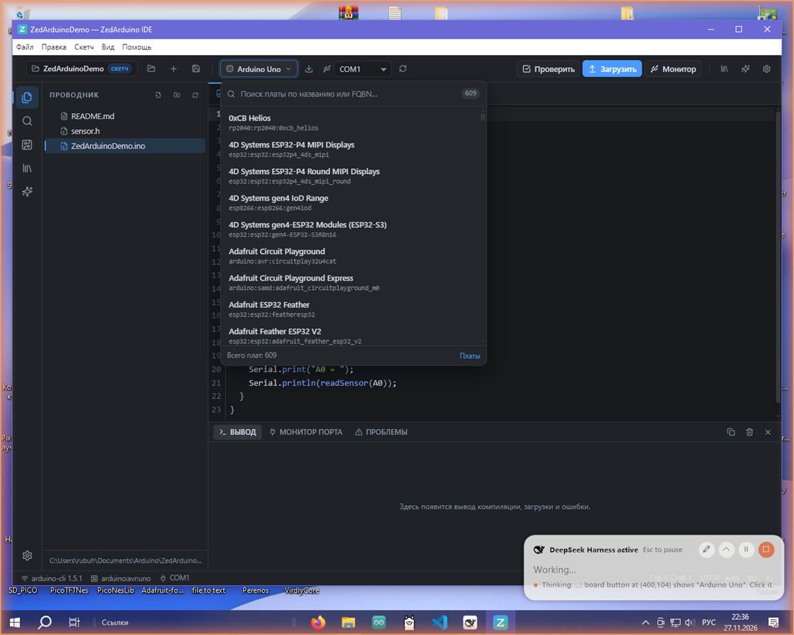
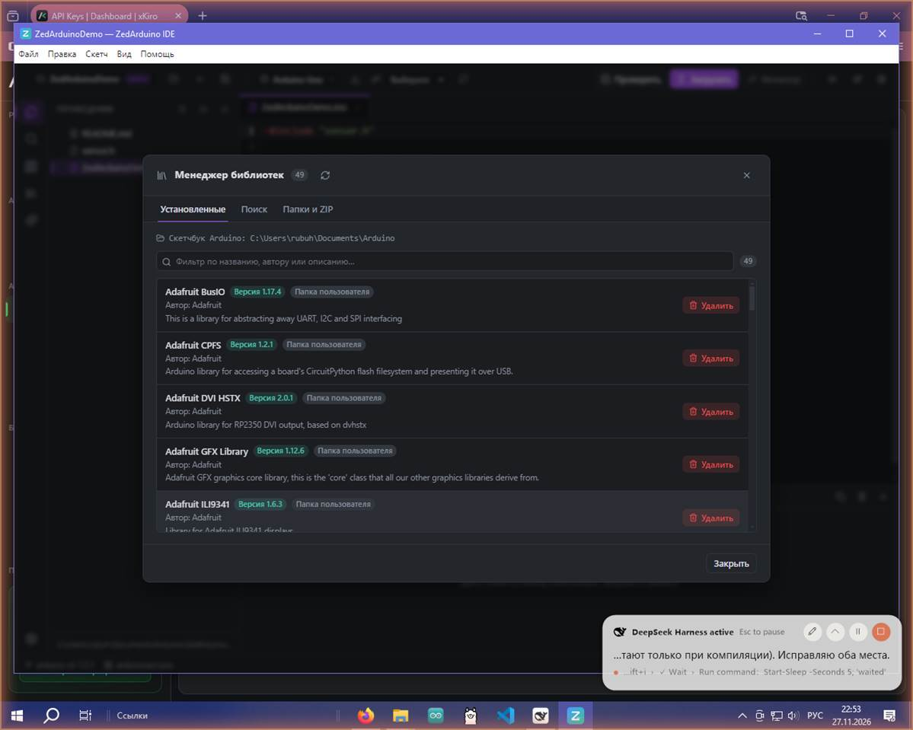
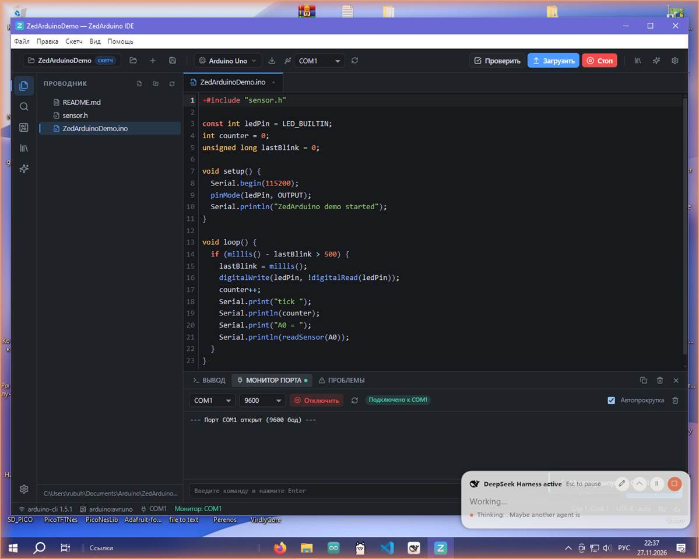
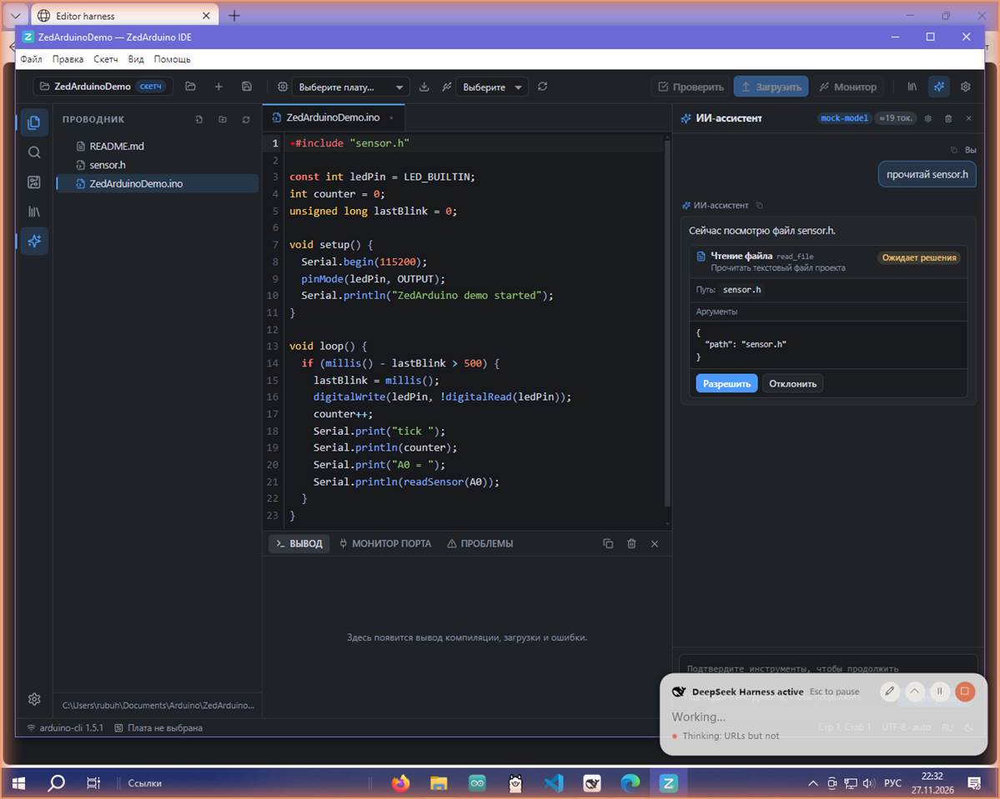

# ZedArduino IDE


**A fast Zed-style editor and Arduino IDE tooling in one program.**
A standalone shell (not a Zed build, not Theia): Electron 33 + React 18 + TypeScript + CodeMirror 6.
Russian UI by default, English available; dark/light/fully custom themes.

[Русская версия](README.md) · [Docs](docs/) · [Download](../../releases) · [Roadmap](ROADMAP.md)



## Features

- **Editor** — C/C++/Arduino highlighting, VS Code-like file tree, tabs, find/replace, project search,
  auto-save, indent settings, word wrap, inline compiler error highlighting.
- **Autocomplete** — instant and local: ~190 Arduino API entries (Serial, pinMode, analogRead, constants, types),
  functions/variables/objects/macros from **all project files**, snippets, any-word completion.
- **Boards** — searchable board picker (hundreds of FQBNs), board options (processor/variant), auto-detected ports.
- **Cores** — core manager (install/remove), additional board-manager URLs (JSON), index update.
- **Compile / upload** — `Verify` (Ctrl+B) and `Upload` (Ctrl+U), progress, flash/RAM usage, readable errors.
- **Build terminal** — output panel with the whole arduino-cli log; a `Problems` tab with clickable errors.
- **Serial monitor** — baud rate, sending lines, line endings (`\n`, `\r\n`), auto-scroll, timestamps.
- **Libraries** — search/install/remove, install from ZIP, **extra library folders** (listed and used for builds).
- **AI chat** — any OpenAI-compatible endpoint: base URL, key, model, custom system prompt, streaming.
- **AI tools** — `read_file`, `write_file`, `create_file`, `delete_file`, `list_dir`; every action requires
  explicit approval and is sandboxed to the opened project folder.
- **Themes** — dark, light, custom (all 20 UI/editor colours), accent colour, UI scale.
- **Languages** — Russian (default) and English, switch without restart.

| | |
|---|---|
|  |  |
|  |  |

## Installation

1. Download `ZedArduinoIDE-1.0.0-win64.zip` from [Releases](../../releases).
2. Extract anywhere — it is a portable build, no installer required.
3. Run `ZedArduinoIDE.exe` (or the "ZedArduino IDE" shortcut).
4. Optional: run `install.ps1` (right click → "Run with PowerShell") to install into
   `%LOCALAPPDATA%\Programs\ZedArduino IDE` with Desktop/Start Menu shortcuts. `uninstall.ps1` removes it.

### From source

```powershell
git clone https://github.com/USERNAME/zeduino-ide.git
cd zeduino-ide
npm install
npm run dev        # development (Vite + Electron)
npm run release    # portable build + zip in release\
```

Requirements: Windows 10/11 x64, Node.js 20+, an [arduino-cli](https://arduino.github.io/arduino-cli/)
(the app finds it in `PATH`, inside an installed Arduino IDE, or downloads it on demand).
For offline use, drop `arduino-cli.exe` into the `tools` folder next to the program.

## Quick start

1. `File → Open Folder…` (Ctrl+O) — pick a sketch folder (`.ino`).
2. Pick a board (search by name or FQBN) and a port in the top bar.
3. `Verify` (Ctrl+B), then `Upload` (Ctrl+U).
4. `Monitor` (Ctrl+M) — serial monitor and command input.
5. AI: Ctrl+Shift+A → "Open settings" → paste your API base URL, key and model.

Examples: [`examples/`](examples/).

## Keyboard shortcuts

| Action | Keys |
|---|---|
| Open folder | Ctrl+O |
| New sketch | Ctrl+Shift+N |
| Save / save all | Ctrl+S / Ctrl+Alt+S |
| Verify | Ctrl+B |
| Upload | Ctrl+U |
| Serial monitor | Ctrl+M |
| AI chat | Ctrl+Shift+A |
| Search in project | Ctrl+Shift+F |
| Find / replace | Ctrl+F / Ctrl+H |
| Board / library manager | Ctrl+Shift+B / Ctrl+Shift+I |
| Output panel | Ctrl+` |
| Settings | Ctrl+, |

## Libraries and sketchbook

The app uses the standard Arduino sketchbook (`Documents\Arduino`); if `Documents` is redirected to OneDrive
it automatically finds the real folder containing `libraries` (scored by folder contents). The effective path is
shown in the library manager and in Settings → Arduino.

- Extra library folders (Settings → Arduino) are used for compilation **and shown in the library manager**.
- ZIP install: Library manager → "Folders & ZIP".
- Libraries from extra folders are marked "Extra folder" and must be removed manually in Explorer.

## AI and privacy

- The API key is stored **locally only** in `%APPDATA%\ZedArduino IDE\settings.json`.
- Requests go **only** to the endpoint you configure. No telemetry.
- File tools run only after explicit approval and only inside the opened project folder
  (path escapes are rejected in the main process).
- Details: [docs/AI.md](docs/AI.md).

## Data locations

| Data | Path |
|---|---|
| Settings | `%APPDATA%\ZedArduino IDE\settings.json` |
| Temporary builds | `%APPDATA%\ZedArduino IDE\build\` |
| Cores and board indexes | `%LOCALAPPDATA%\Arduino15` (shared with Arduino IDE) |
| Libraries and sketches | `Documents\Arduino\libraries`, `Documents\Arduino\` |
| arduino-cli downloaded by the app | `%APPDATA%\ZedArduino IDE\tools\arduino-cli.exe` |

## Project status and limitations

- Upload was verified on an Arduino Uno (AVR); other boards use the standard `arduino-cli upload`.
- Windows SmartScreen may warn because the build is not code-signed (see [PUBLISHING](docs/PUBLISHING.md)).
- No auto-update yet — new versions are installed by extracting the new archive.
- No unit tests yet (CI runs `tsc --noEmit` and a full build). Plans: [ROADMAP](ROADMAP.md).

## Contributing

Issues and pull requests are welcome. See [CONTRIBUTING](CONTRIBUTING.md), [SECURITY](SECURITY.md),
[CODE_OF_CONDUCT](CODE_OF_CONDUCT.md).

## License

MIT — see [LICENSE](LICENSE). Third-party notices: [THIRD-PARTY-NOTICES](THIRD-PARTY-NOTICES.md).

Arduino® is a trademark of Arduino S.r.l. Zed is a trademark of Zed Industries, Inc.
This project is not affiliated with Arduino or Zed.
