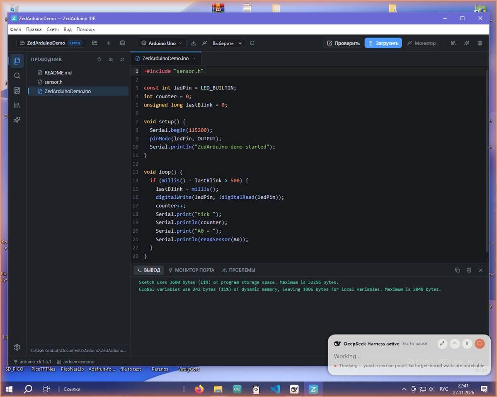
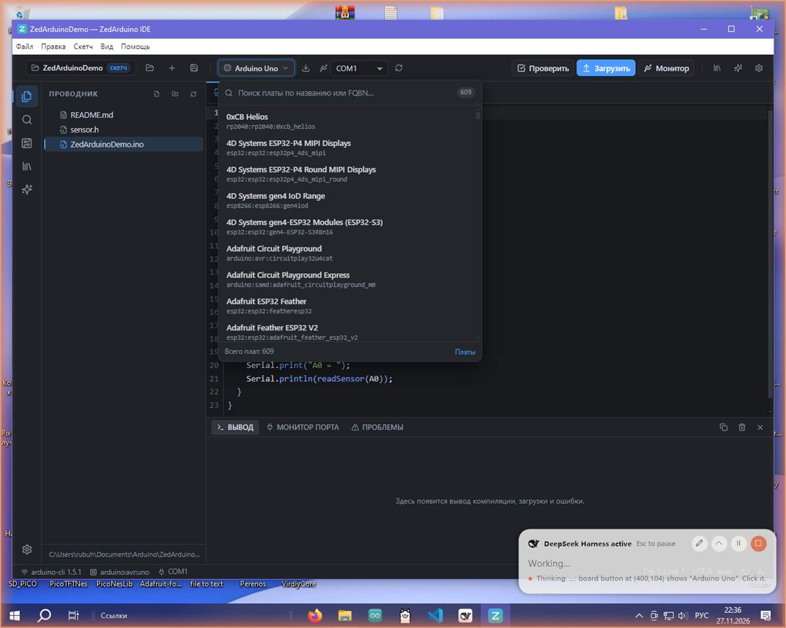
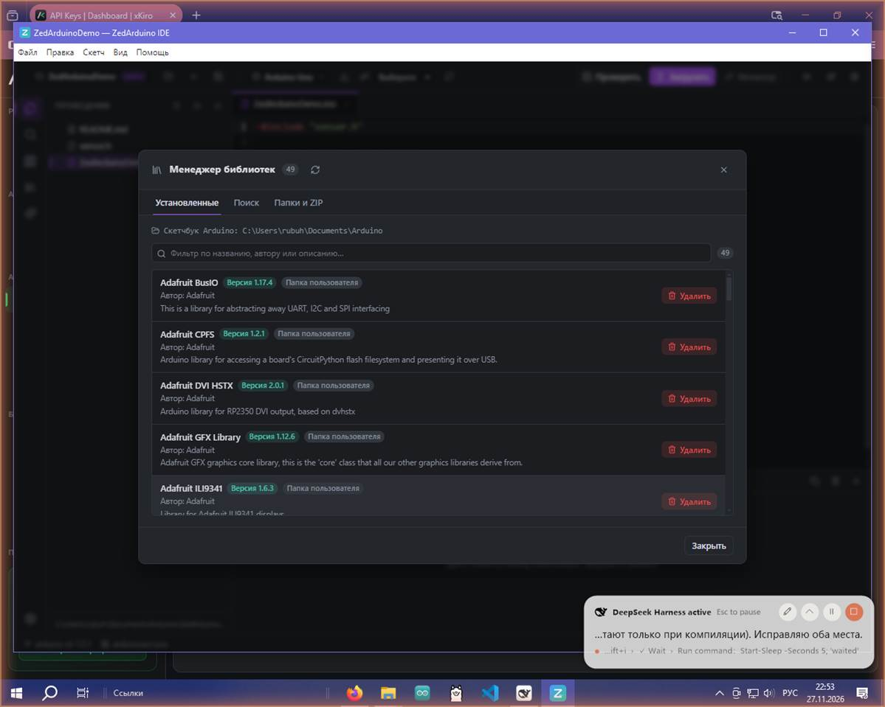
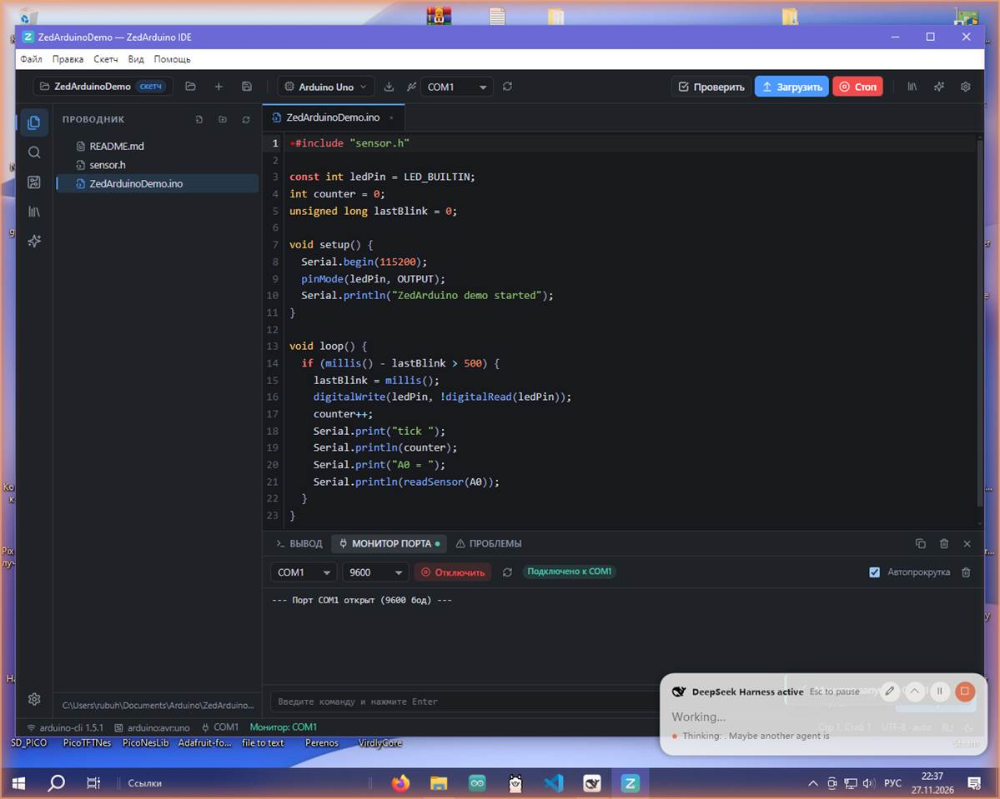
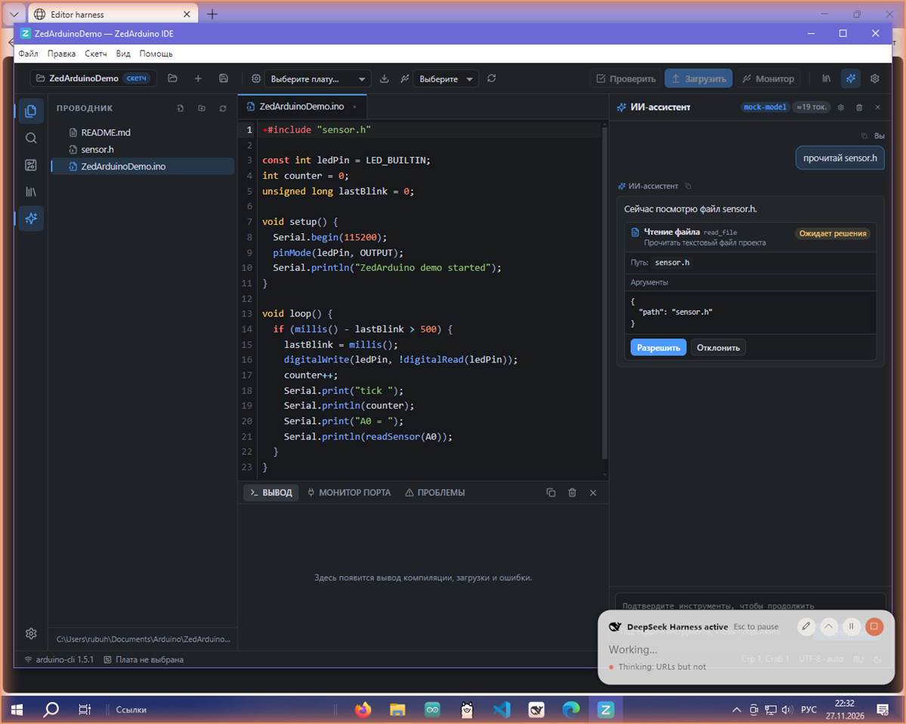
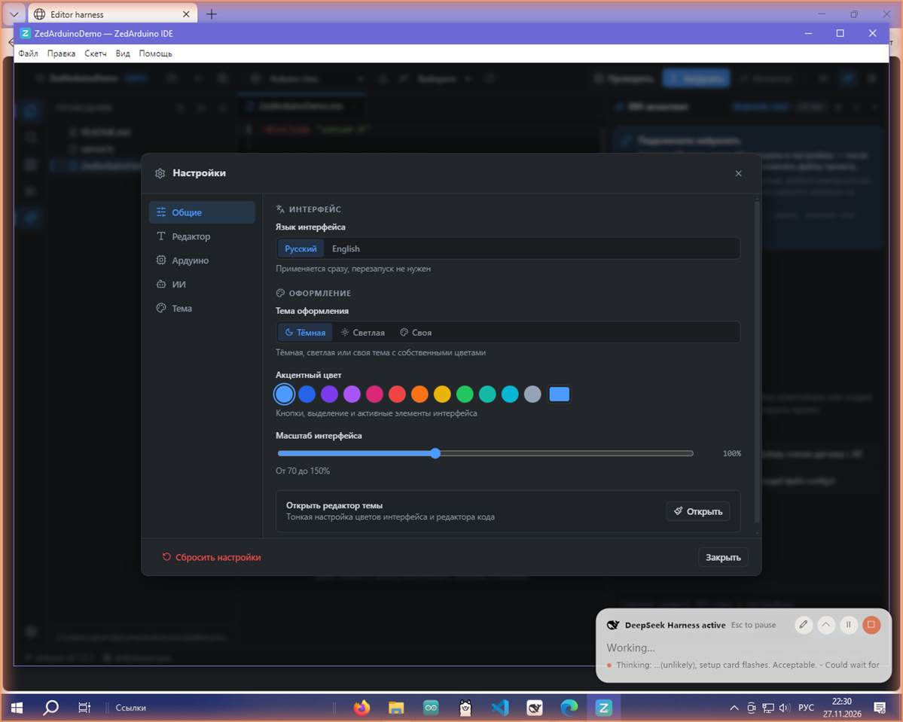
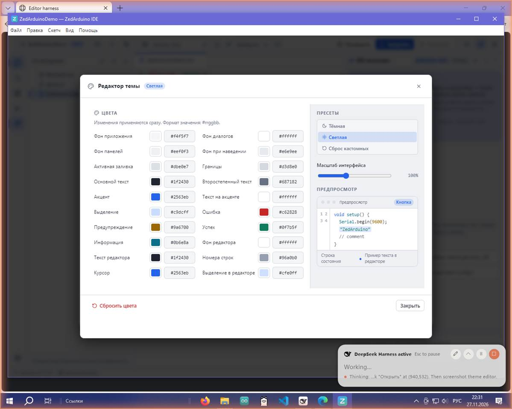

# ZedArduino IDE


**Быстрый редактор в духе Zed + инструменты Arduino IDE в одной программе.**  
Собственная лёгкая оболочка (не сборка Zed и не Theia): Electron 33 + React 18 + TypeScript + CodeMirror 6.
Интерфейс на русском (есть английский), тёмная/светлая/полностью кастомная тема.

[English version](README.en.md) · [Документация](docs/) · [Скачать](../../releases) · [Дорожная карта](ROADMAP.md)



## Возможности

| | |
|---|---|
| **Редактор** | Подсветка C/C++/Arduino, дерево файлов как в VS Code, вкладки, поиск/замена, поиск по проекту, автосохранение, отступы, перенос строк, подсветка ошибок компиляции, **автоформат кода (Ctrl+T)** |
| **Автодополнение** | Мгновенное, локальное: ~190 записей Arduino API (Serial, pinMode, analogRead, константы, типы), функции/переменные/объекты/макросы **из всех файлов проекта**, сниппеты, авто-слово |
| **Платы** | Поиск по всем установленным платам (сотни FQBN), настройки платы (процессор/вариант), автоопределение подключённых плат и портов |
| **Ядра** | Менеджер ядер (установка/удаление), дополнительные ссылки менеджера плат (JSON), обновление индекса |
| **Компиляция** | `Проверить` (Ctrl+B) и `Загрузить` (Ctrl+U), прогресс, размер прошивки и RAM, понятные ошибки |
| **Терминал сборки** | Панель «Вывод»: весь процесс arduino-cli; вкладка «Проблемы» — кликабельные ошибки с переходом на строку |
| **Монитор порта** | Скорость, отправка строк, окончание строки (`\n`, `\r\n`), автоскролл, метки времени |
| **Библиотеки** | Менеджер: поиск/установка/удаление, установка из ZIP, **свои дополнительные папки библиотек** (показываются в списке и используются при сборке) |
| **ИИ-чат** | Любой OpenAI-совместимый API: адрес, ключ, модель, свой системный промт, стриминг ответа |
| **Инструменты ИИ** | `read_file`, `write_file`, `create_file`, `delete_file`, `list_dir` — каждое действие только после кнопки «Разрешить», только внутри папки проекта |
| **Темы** | Тёмная, светлая, своя (все 20 цветов интерфейса и редактора), акцент, масштаб интерфейса |
| **Языки** | Русский (по умолчанию) и английский, переключение без перезапуска |

### Скриншоты

| | |
|---|---|
|  |  |
|  |  |
|  |  |

## Установка

### Вариант 1. Готовый архив (рекомендуется)

1. Скачайте `ZedArduinoIDE-1.0.0-win64.zip` со страницы [Releases](../../releases).
2. Распакуйте в любую папку (портативная сборка, установка не обязательна).
3. Запустите `ZedArduinoIDE.exe` или ярлык «ZedArduino IDE».
4. По желанию: `install.ps1` (правой кнопкой → «Выполнить с помощью PowerShell») установит программу в
   `%LOCALAPPDATA%\Programs\ZedArduino IDE` и создаст ярлыки на рабочем столе и в меню «Пуск».
   Удаление — `uninstall.ps1` (ключ `-RemoveSettings` удалит и настройки).

### Вариант 2. Из исходников

```powershell
git clone https://github.com/Virdly/zeduino-ide.git
cd zeduino-ide
npm install
npm run dev        # режим разработки (Vite + Electron)
npm run release    # готовая сборка + zip в release\
```

Подробно: [docs/BUILDING.md](docs/BUILDING.md).

### Требования

- Windows 10/11 x64
- [arduino-cli](https://arduino.github.io/arduino-cli/) — необязательно ставить отдельно: программа находит его в `PATH`,
  в установленной Arduino IDE или скачивает по кнопке «Установить» в менеджере плат. Свой путь — в Настройках → Ардуино.
  Для работы офлайн положите `arduino-cli.exe` в папку `tools` рядом с программой.
- Для сборки из исходников: Node.js 20+ и npm.

## Быстрый старт

1. `Файл → Открыть папку…` (Ctrl+O) — выберите папку со скетчем (`.ino`).
2. Выберите плату в поиске плат вверху (по названию или FQBN) и порт.
3. `Проверить` (Ctrl+B) → `Загрузить` (Ctrl+U).
4. `Монитор` (Ctrl+M) — монитор порта и отправка команд.
5. ИИ: `Ctrl+Shift+A` → «Открыть настройки» → вставьте адрес API, ключ и модель.

Готовые примеры: [`examples/`](examples/) (открываются в IDE как папки).

## Горячие клавиши

| Действие | Клавиши |
|---|---|
| Открыть папку | Ctrl+O |
| Новый скетч | Ctrl+Shift+N |
| Сохранить / сохранить все | Ctrl+S / Ctrl+Alt+S |
| Проверить (компиляция) | Ctrl+B |
| Загрузить на плату | Ctrl+U |
| Выровнять код (автоформат) | Ctrl+T |
| Монитор порта | Ctrl+M |
| Чат с ИИ | Ctrl+Shift+A |
| Поиск по проекту | Ctrl+Shift+F |
| Поиск / замена в файле | Ctrl+F / Ctrl+H |
| Менеджер плат / библиотек | Ctrl+Shift+B / Ctrl+Shift+I |
| Панель вывода | Ctrl+` |
| Настройки | Ctrl+, |
| Масштаб | Ctrl+= / Ctrl+− / Ctrl+0 |

## Библиотеки и скетчбук

Программа использует стандартный скетчбук Arduino (`Документы\Arduino`), но если «Документы» перенаправлены
в OneDrive, находит настоящую папку с библиотеками автоматически (по содержимому папки `libraries`).
Путь по умолчанию можно увидеть в менеджере библиотек и в Настройках → Ардуино.

- Дополнительные папки библиотек (Настройки → Ардуино) используются при компиляции **и показываются в менеджере**.
- Установка из ZIP: Менеджер библиотек → «Папки и ZIP».
- Библиотеки из дополнительных папок помечаются «Доп. папка»; удалять их нужно вручную в проводнике.

## ИИ и приватность

- Ключ хранится **только локально** в `%APPDATA%\ZedArduino IDE\settings.json`.
- Запросы уходят **только** на указанный вами адрес API. Телеметрии нет.
- Инструменты работы с файлами выполняются только после подтверждения и только внутри открытой папки проекта
  (выход за её пределы блокируется в основном процессе).
- Подробнее: [docs/AI.md](docs/AI.md).

## Где хранятся данные

| Что | Где |
|---|---|
| Настройки | `%APPDATA%\ZedArduino IDE\settings.json` |
| Временная сборка | `%APPDATA%\ZedArduino IDE\build\` |
| Ядра и индексы плат | `%LOCALAPPDATA%\Arduino15` (общая папка с Arduino IDE) |
| Библиотеки и скетчи | `Документы\Arduino\libraries`, `Документы\Arduino\` |
| arduino-cli, скачанный программой | `%APPDATA%\ZedArduino IDE\tools\arduino-cli.exe` |

## Структура репозитория

```
src/
  main/       Electron main: arduino-cli, монитор порта, файлы, прокси ИИ, настройки
  preload/    безопасный мост window.api
  renderer/   React-интерфейс: редактор, дерево, панели, диалоги, ИИ-чат, темы
  shared/     общие типы, настройки по умолчанию, палитры тем
scripts/      сборка, dev-режим, упаковка, zip, иконка
docs/         архитектура, сборка, ИИ, публикация, разработка
examples/     примеры скетчей
.github/      CI, release workflow, шаблоны issues/PR
install.ps1   установка портативной сборки
```

Подробнее: [ARCHITECTURE](docs/ARCHITECTURE.md) · [BUILDING](docs/BUILDING.md) · [DEVELOPMENT](docs/DEVELOPMENT.md) · [PUBLISHING](docs/PUBLISHING.md).

## Статус и ограничения

- Загрузка на реальную плату проверена на Arduino Uno (AVR); для остальных плат используется штатный `arduino-cli upload`.
- Windows SmartScreen может предупреждать — сборка не подписана сертификатом (см. [PUBLISHING](docs/PUBLISHING.md)).
- Автообновления пока нет, новая версия ставится распаковкой нового архива.
- Юнит-тестов пока нет (в CI: `tsc --noEmit` + сборка). Планы — в [ROADMAP](ROADMAP.md).

## Участие

Issues и pull request'ы приветствуются. См. [CONTRIBUTING](CONTRIBUTING.md), [SECURITY](SECURITY.md), [CODE_OF_CONDUCT](CODE_OF_CONDUCT.md).

## Лицензия

MIT — см. [LICENSE](LICENSE). Сторонние компоненты: [THIRD-PARTY-NOTICES](THIRD-PARTY-NOTICES.md).

Arduino® — торговая марка Arduino S.r.l. Zed — торговая марка Zed Industries, Inc.
Проект не аффилирован ни с Arduino, ни с Zed.
