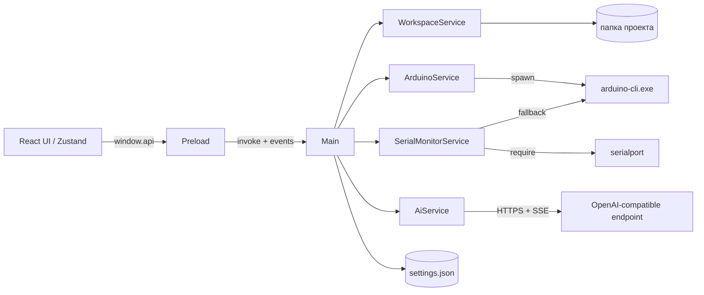

# Архитектура ZedArduino IDE

Документ описывает фактическое устройство приложения версии 1.0.0: процессы Electron, IPC, состояние интерфейса, конвейер редактора и автодополнения, интеграцию с `arduino-cli`, монитор порта, ИИ-чат, настройки/темы и упаковку. Сборка описана в [BUILDING](BUILDING.md), ИИ — в [AI](AI.md), соглашения разработки — в [DEVELOPMENT](DEVELOPMENT.md).

Приложение — локальное Windows-приложение. Собственного сервера нет: сетевые обмены — обращение к настроенному пользователем OpenAI-совместимому endpoint (ИИ), загрузка `arduino-cli` с GitHub и команды `arduino-cli` (ядра, библиотеки, индексы).

## 1. Общая схема

```text
┌──────────────────────────────────────────────────────────────────────────┐
│ Renderer (Chromium)                                                      │
│ React 18 · Zustand store · CodeMirror 6 · CSS-переменные тем             │
│ окно: Toolbar / ActivityBar / Sidebar / вкладки / панель / ИИ-чат        │
└───────────────────────────────┬──────────────────────────────────────────┘
                                │ window.api (contextBridge, типизированный)
┌───────────────────────────────┴──────────────────────────────────────────┐
│ Preload (CJS, contextIsolation)                                           │
│ invoke(IPC.*) + подписки на события EVENT_CHANNELS                        │
└───────────────────────────────┬──────────────────────────────────────────┘
                                │ ipcRenderer.invoke / webContents.send
┌───────────────────────────────┴──────────────────────────────────────────┐
│ Main (Node.js 20, Electron 33)                                            │
│ settingsStore · WorkspaceService · ArduinoService · SerialMonitorService  │
│ AiService                                                                 │
└───────┬───────────────────┬────────────────────┬─────────────────────────┘
        │                   │                    │
   файловая система     arduino-cli         serialport (native)
   (проект, настройки)  (spawn/stream)      или arduino-cli monitor
```



## 2. Процессы

### 2.1 Main

Точка входа — `src/main/index.ts`. При старте:

1. `app.setName('ZedArduino IDE')`.
2. Запрашивается single-instance lock; второй экземпляр только восстанавливает и фокусирует окно.
3. После `app.whenReady()`: `settingsStore.init()`, затем создаются сервисы, регистрируются IPC, строится меню, создаётся окно.
4. Если `lastProject` из настроек существует, проект открывается в фоне.
5. `window-all-closed` завершает приложение (в том числе на macOS-коде, но целевая платформа — Windows).
6. `before-quit` останавливает монитор и отменяет активный процесс `arduino-cli`.

Окно: 960×600 минимум, стартовый размер до 1480×920 по рабочей области, `show: false` до `ready-to-show`, фон `#1b1d21`, иконка окна — `dist/renderer/icon.ico`; `resources/icon.ico` копируется для ярлыка и упаковки. `webPreferences`: `contextIsolation: true`, `nodeIntegration: false`, `sandbox: false` (preload собирается в CJS и использует Node-модули), `webSecurity: true`, `spellcheck: false`. В dev загружается `VITE_DEV_SERVER_URL`, иначе `dist/renderer/index.html`.

Все новые окна запрещены (`setWindowOpenHandler` → `deny`), ссылки `http(s)` открываются во внешнем браузере через `shell.openExternal`. Это правило продублировано на уровне `web-contents-created`.

Сервисы:

| Сервис | Файл | Ответственность |
| --- | --- | --- |
| `settingsStore` | `src/main/settings.ts` | чтение/запись `settings.json`, deep-merge патчей |
| `WorkspaceService` | `src/main/workspace.ts` | проект, дерево файлов, чтение/запись, поиск, индекс, `fs.watch` |
| `ArduinoService` | `src/main/arduino.ts` | поиск/установка CLI, платы, ядра, библиотеки, compile/upload, fallback-монитор |
| `SerialMonitorService` | `src/main/serial.ts` | выбор backend, открытие/закрытие порта, отправка |
| `AiService` | `src/main/ai.ts` | потоковый запрос к API, накопление tool calls, выполнение инструментов |

Вспомогательные функции (`src/main/util.ts`): `runCommand` (короткие запросы с таймаутом), `spawnStream` (потоковый вывод + `taskkill /pid /f /t`), `downloadFile` (fetch → `.part` → rename), `extractZip` (системный `tar`), `stripAnsi`, `slugify`.

### 2.2 Preload

`src/preload/index.ts` собирает объект `ZedArduinoApi` и публикует его как `window.api` через `contextBridge`. Каждый метод — обёртка над `ipcRenderer.invoke(IPC.<name>, ...)`. Ошибки нормализуются: из сообщения убирается префикс Electron `Error invoking remote method '...'`. Подписки `on*` возвращают функцию отписки и не пропускают `IpcRendererEvent` в renderer.

Контракт API и имена каналов лежат в `src/shared/api.ts`; типы — в `src/shared/types.ts`; `window.api` объявлен в `src/renderer/global.d.ts`.

### 2.3 Renderer

`src/renderer/main.tsx` монтирует `<App />` в `#root`. `App.tsx` отвечает за каркас: тулбар, activity bar, сайдбар, вкладки, редактор, нижняя панель, ИИ-панель, статус-бар, оверлеи и диалоги. Глобальные горячие клавиши (`Ctrl+B`, `Ctrl+U`, `Ctrl+M`, `Ctrl+Shift+A`, Ctrl+обратная кавычка и т. д.) обрабатываются в `App.tsx` и дублируют меню.

Состояние — один Zustand-store (`src/renderer/state/store.ts`); редактор — CodeMirror 6 (`src/renderer/editor/`); ИИ-чат имеет отдельный модульный Zustand-store (`src/renderer/ai/useAiChat.ts`), чтобы поток продолжал собираться при закрытой панели. Стили — обычный CSS с переменными (`styles/theme.css`, `app.css`, `editor.css`, `dialogs.css`, `ai.css`).

### 2.4 Shared

`src/shared/` не импортирует Electron и Node API, поэтому используется и в main, и в preload, и в renderer:

| Файл | Содержимое |
| --- | --- |
| `api.ts` | `ZedArduinoApi`, константы `IPC` (53 invoke-канала) и `EVENT_CHANNELS` (14 событий), `ProjectIndex` |
| `types.ts` | настройки, доменные типы (платы, ядра, библиотеки), события `AppEventMap` |
| `defaults.ts` | `DEFAULT_SETTINGS`, шрифт редактора по умолчанию |
| `theme.ts` | палитры `DARK_COLORS` / `LIGHT_COLORS`, `withAlpha`, `mixColors`, `isLight` |

## 3. IPC

### 3.1 Соглашения

- Все запросы — `ipcMain.handle` через локальную обёртку `handle(channel, fn)`: она ловит исключение и пробрасывает `Error` с исходным сообщением. Renderer получает человекочитаемый текст, preload снимает Electron-префикс.
- События main → renderer идут через `emit(channel, payload)` и `mainWindow.webContents.send`. Renderer подписывается методами `onOutput`, `onState`, `onChunk` и т. п.
- Каналы — строковые константы; добавлять «сырые» строки в сервисах не принято, кроме трёх служебных `window:*` обработчиков (см. ниже).

### 3.2 Invoke-каналы

| Группа | Каналы | Назначение |
| --- | --- | --- |
| `app` | `app:info`, `app:open-external`, `app:open-path`, `app:pick-folder`, `app:pick-file`, `app:show-item` | сведения о сборке, внешние ссылки, диалоги выбора, проводник |
| `settings` | `settings:get`, `settings:update`, `settings:reset` | настройки целиком и частичные патчи |
| `project` | `project:current`, `project:open`, `project:open-dialog`, `project:close`, `project:recent`, `project:tree`, `project:read-file`, `project:write-file`, `project:create-file`, `project:create-folder`, `project:rename`, `project:remove`, `project:reveal`, `project:create-sketch`, `project:index`, `project:search` | файловые операции и индекс |
| `arduino` | `arduino:status`, `arduino:ensure-cli`, `arduino:choose-cli`, `arduino:update-index`, `arduino:cores`, `arduino:core-search`, `arduino:core-install`, `arduino:core-uninstall`, `arduino:boards`, `arduino:ports`, `arduino:serial-ports`, `arduino:board-details`, `arduino:compile`, `arduino:upload`, `arduino:cancel`, `arduino:libraries`, `arduino:lib-search`, `arduino:lib-install`, `arduino:lib-install-zip`, `arduino:lib-uninstall` | инструменты Arduino |
| `monitor` | `monitor:start`, `monitor:stop`, `monitor:send`, `monitor:state` | последовательный порт |
| `ai` | `ai:chat`, `ai:abort`, `ai:exec-tool` | стрим ответа, отмена, выполнение одобренного инструмента |
| `dirs` | `dirs:list` | листинг произвольной папки для менеджеров |

Дополнительно в `src/main/index.ts` зарегистрированы `window:minimize`, `window:maximize`, `window:close`; в `ZedArduinoApi` они не входят и из текущего renderer не вызываются (окно системное).

### 3.3 События

| Канал | Payload | Когда |
| --- | --- | --- |
| `arduino:output` | `{ runId, stream, text }` | поток вывода compile/upload/cli/setup |
| `arduino:run-started` | `{ runId, kind, title }` | старт операции |
| `arduino:run-done` | `{ runId, ok, exitCode, durationMs, kind }` | завершение операции |
| `arduino:progress` | `{ task, percent?, detail? }` | прогресс установки CLI и др. |
| `monitor:data` | `{ port, text, kind }` | данные/ошибка/служебная строка порта |
| `monitor:state` | `{ running, port?, baud?, error? }` | открытие/закрытие/ошибка |
| `ai:chunk` | `{ requestId, delta }` | текстовая дельта SSE |
| `ai:tools` | `{ requestId, calls }` | модель запросила инструменты |
| `ai:done` | `{ requestId, ok, error?, content?, finishReason? }` | завершение запроса |
| `project:changed` | `ProjectInfo \| null` | открытие/закрытие проекта |
| `project:fs-changed` | `{ root, time }` | debounce 350 мс после `fs.watch` |
| `app:menu` | `{ action }` | пункт нативного меню |
| `app:toast` | `{ kind, message }` | канал объявлен, но UI использует собственные тосты |
| `cli:status` | `CliStatus` | смена пути CLI после выбора |

### 3.4 Меню

Меню строится в `buildMenu()` и жёстко написано по-русски (не локализуется). Пункты отправляют `app:menu` с action, который разбирает `useApp.runAction`: `new-sketch`, `open-folder`, `save`, `save-all`, `settings`, `compile`, `upload`, `monitor`, `plotter` (открывает монитор), `boards`, `libraries`, `theme-light`, `theme-dark`, `theme-editor`, `toggle-sidebar`, `toggle-panel`, `toggle-ai`, `zoom-in/out/reset`, `search-project`, `find`, `replace`. `find`/`replace` транслируются в DOM-событие `zeduino:editor`, которое слушает CodeMirror.

## 4. Состояние (Zustand)

`AppStore` — единый store без middleware. Ключевые группы полей:

| Группа | Поля |
| --- | --- |
| готовность | `ready` |
| настройки | `settings` (копия из main), `recent` |
| проект | `project`, `tree` |
| редактор | `tabs`, `activePath` |
| раскладка | `sidebarView`, `sidebarVisible`, `panelVisible`, `panelView`, `panelHeight`, `aiVisible`, `dialogs` |
| оверлеи | `prompt`, `confirm`, `toast` |
| вывод | `output`, `problems`, `running`, `progress`, `lastCompile`, `statusText` |
| Arduino | `ports`, `boards`, `boardDetails`, `cliStatus` |
| поиск | `searchQuery`, `searchResults`, `searchBusy` |
| монитор | `monitor { running, port, baud, buffer, timestamps, autoScroll }` |
| ИИ | `aiBusy` (индикатор занятости чата в статус-баре) |

Поток инициализации `init()`:

1. Параллельно читаются `settings`, текущий проект, список недавних.
2. Применяется тема, загружается дерево; для скетча автоматически открывается `<sketchName>.ino`.
3. Подписываются события Arduino, монитора, проекта, меню.
4. Загружаются статус CLI, платы и порты; каждые 7 секунд порты обновляются, если нет активной операции.
5. `updateTabContent` планирует автосохранение (по умолчанию через 900 мс, минимум 300 мс) для текстовых расширений.

Особенности:

- Источник истины по настройкам — main (`settingsStore`); renderer после каждого патча получает полный объект и применяет тему. Настройки не дублируются в localStorage.
- `tabs` хранят `content` и `saved`; грязный таб определяется сравнением. Внешнее изменение файла на диске перечитывается только если таб чистый (`reloadActiveIfClean`).
- Файловый watcher: `fs.watch(root, { recursive: true })`, debounce 350 мс → `project:fs-changed`; renderer обновляет дерево и чистый активный файл с задержкой 300 мс.
- Вывод ограничен 4000 строками; буфер монитора — 200 000 символов. Проблемы компиляции парсятся из строк вывода, дубликаты по `file:line` заменяются, хранится до 800.
- Тосты живут 5 секунд; подтверждения/промпты — оверлеи, а не нативные диалоги.

## 5. Редактор и автодополнение

### 5.1 CodeEditor

`src/renderer/editor/CodeEditor.tsx` создаёт `EditorView` один раз на файл. Вкладки используют `key={activeTab.path}`, поэтому при переключении файла создаётся отдельный экземпляр редактора (история на файл). Внутри одного экземпляра настройки применяются через `Compartment`-ы, не пересоздавая state:

| Compartment | Что переключает |
| --- | --- |
| `language` | `cpp()` для `.ino/.pde/.h/.hpp/.c/.cpp/...`, иначе plain text |
| `indent` | `tabSize` и `indentUnit` (пробелы) |
| `wrap` | перенос строк |
| `gutters` | номера строк + active line gutter |
| `activeLine` | подсветка активной строки |
| `bracket` | `bracketMatching` |
| `autocomplete` | источник автодополнения |
| `theme` | CSS-переменные редактора |
| `ui` | локализованные aria-label, phrases поиска, placeholder |

Внешняя замена документа (открытие файла, перечитывание с диска) помечается аннотацией `externalChange`, чтобы не засорять undo. `Ctrl+S` и `Mod-s` вызывают `onSave`; `Tab` вставляет пробелы или делает отступ, если есть выделение; сниппеты перехватывают `Tab` раньше. Курсор/выделение отдаются в статус-бар. Глобальные `find`/`replace` из меню открывают панель поиска CodeMirror.

Проблемы компиляции накладываются на документ через `@codemirror/lint` (`setDiagnostics`) для открытого файла.

### 5.2 Конвейер автодополнения

```text
typing
  └─ CodeMirror autocompletion (delay 40 ms)
       └─ CompletionSource (синхронный, только кэш)
            ├─ document symbols (этот файл, debounce 180 мс)
            ├─ workspace symbols (индекс проекта, debounce 800 мс)
            ├─ Arduino API (187 записей)
            └─ локальные сниппеты
```

- `createCompletionBundle` кэширует плоский массив `Completion[]`; `invalidate()` сбрасывает кэш при изменении документа/языка/индекса. Перевод секций берётся лениво, поэтому смена языка не требует пересборки данных.
- Дедупликация по `label.toLowerCase()`: символы текущего документа (boost 30) важнее символов проекта (boost 15), затем Arduino API и сниппеты (boost 5).
- Для `Object.method` источник предлагает только записи, начинающиеся с `Object.`, и заменяет весь фрагмент, включая имя объекта.
- `completeAnyWord` подключён как второй источник CodeMirror; попап рендерится в `document.body`, чтобы не обрезаться панелью.

### 5.3 Индекс символов

`src/renderer/editor/indexer.ts` получает `window.api.project.index()`:

- main читает текстовые файлы проекта: максимум 400 файлов, 24 МБ суммарно, не более 2 МБ на файл, глубина 10, игнорируя `node_modules`, `.git`, `.zeduino`, `.zed-build`, `dist`, `release` и скрытые каталоги.
- renderer парсит их дешёвыми регулярными выражениями: функции, методы, `class/struct/enum`, `typedef`, `#define`, глобальные переменные. Комментарии вырезаются, строковые литералы маскируются с сохранением структуры строк.
- Ограничения: 300 000 символов на файл, 160 символов на файл, 4000 символов на проект; работа перемежается `requestIdleCallback` каждые 6 файлов. Повторные `refreshIndex()` коалесцируются.
- Символы открытого документа обновляются отдельно с debounce 180 мс и хранятся в LRU-кэше на 12 файлов; это ускоряет автодополнение по мере набора.

### 5.4 Arduino API и подсветка

`src/renderer/editor/arduino-api.ts` — статические данные без импортов CodeMirror: функции, переменные, типы, ключевые слова и сниппеты, разбитые на секции (`digital`, `analog`, `advanced`, `time`, `math`, `trig`, `random`, `bits`, `interrupts`, `serial`, `string`, `constants`, `types`, `keywords`, `snippets`). Сниппеты используют `${1:...}` и `${}`.

Подсветка синтаксиса — `HighlightStyle` на CSS-переменных `--editor-syntax-*`; тёмные/светлые значения выбираются через `[data-theme]` в `editor.css` (встроенная тема CodeMirror не используется).

## 6. Интеграция с arduino-cli

### 6.1 Поиск исполняемого файла

Порядок `resolveCli()`:

1. `settings.arduino.cliPath`, если файл существует.
2. Каталоги установленной Arduino IDE:
   - `%LOCALAPPDATA%\Programs\Arduino IDE`
   - `%LOCALAPPDATA%\Programs\arduino-ide`
   - `%ProgramFiles%\Arduino IDE`
   - `%ProgramFiles(x86)%\Arduino IDE`

   В каждом проверяются:
   - `resources\app\lib\backend\resources\arduino-cli.exe` (актуальная раскладка Arduino IDE 2.x);
   - `resources\app\node_modules\arduino-ide-extension\build\arduino-cli.exe` (старая раскладка).
3. Собственная копия `%APPDATA%\ZedArduino IDE\tools\arduino-cli.exe`.
4. `where arduino-cli` (PATH).

Результат кэшируется на 15 секунд в `status()` (флаг `force` сбрасывает).

### 6.2 Установка CLI

`ensureCli()` (одновременные вызовы коалесцируются):

1. Проверяет `status(true)`; если CLI уже работает — возвращает.
2. Запрашивает GitHub API `repos/arduino/arduino-cli/releases/latest` и формирует URL Windows x64 zip.
3. Добавляет запасные версии `1.2.2`, `1.1.1`, `1.0.4` (если API недоступен или rate limit).
4. Скачивает в `%APPDATA%\ZedArduino IDE\tools\arduino-cli.zip` с прогрессом `arduino:progress` (`task: cli-download`), распаковывает системным `tar`, рекурсивно ищет `arduino-cli.exe`, копирует в `tools\arduino-cli.exe`, удаляет временные файлы.
5. Повторно проверяет `status(true)`; при ошибке запуска — исключение.

Путь можно задать вручную: `arduino:choose-cli` открывает диалог и сохраняет `cliPath`.

### 6.3 Окружение и каталоги

Перед каждым запуском CLI создаются каталоги и выставляется окружение:

| Переменная | Значение |
| --- | --- |
| `ARDUINO_DIRECTORIES_DATA` | `%LOCALAPPDATA%\Arduino15` |
| `ARDUINO_DIRECTORIES_USER` | выбранный sketchbook (см. ниже) |
| `ARDUINO_BOARD_MANAGER_ADDITIONAL_URLS` | `arduino.additionalUrls` через запятую (если заданы) |
| `NO_COLOR` | `1` |
| `LANG`, `LC_ALL` | `en_US.UTF-8` |

Дополнительно создаётся `%APPDATA%\ZedArduino IDE\build`. Каталог данных общий с Arduino IDE, поэтому уже установленные ядра и библиотеки видны сразу.

### 6.4 Sketchbook

Если `arduino.sketchbookDir` не задан, каталог выбирается эвристикой по кандидатам:

- `%USERPROFILE%\Documents\Arduino`
- `%USERPROFILE%\Documents\ArduinoData`
- `%USERPROFILE%\Documents\Arduino` (через `app.getPath('documents')`, может быть перенаправлен)
- `%USERPROFILE%\OneDrive\Documents\Arduino`
- `%USERPROFILE%\OneDrive\Документы\Arduino`

Каждый существующий кандидат получает score = 1 + 10 × количество элементов в его `libraries`; выбирается максимум. Смысл: Documents может быть перенаправлен в OneDrive, а реальные библиотеки остались в физической папке. Если ничего не существует — `Documents\Arduino`.

### 6.5 Платы, порты, ядра

| Операция | Команда/источник | Особенности |
| --- | --- | --- |
| статус | `arduino-cli version --format json --no-color` | кэш 15 с, версия из `VersionString` или regex |
| список плат | `board listall --no-color` | текстовый парсинг «имя + FQBN», кэш 120 с |
| подключённые платы | `board list --format json` | `detected_ports` → порт, protocol, matching board |
| порты без CLI | PowerShell `[System.IO.Ports.SerialPort]::GetPortNames()` | fallback, если CLI не найден/не дал портов |
| настройки платы | `board details -b <fqbn> --format json` | `config_options` → группы значений |
| поиск ядер | `core search [query] --format json` | id, name, latest version |
| установленные ядра | `core list --format json` | installed/latest |
| установка/удаление ядра | `core install/uninstall <id>` | потоковый вывод, сброс кэшей |
| обновление индексов | `core update-index` | потоковый вывод, кнопка в настройках |

Ошибки очищаются от ANSI и прогресс-баров; показываются последние 6 значимых строк (`cleanCliError`).

### 6.6 Компиляция и загрузка

FQBN собирается как `<fqbn>:<option>=<value>,...`, если в `boardOptions` есть значения и FQBN ещё не содержит опций. Параметры платы по умолчанию заполняются из `board details` при выборе платы.

Компиляция:

```text
arduino-cli compile --fqbn <fqbn> --build-path <buildRoot/slug(sketchDir)>
  --warnings default --no-color [--verbose] [--libraries <dir> ...] <sketchDir>
```

- Перед компиляцией main останавливает монитор порта.
- Требуется файл `.ino` в папке скетча.
- Потоковый вывод → `arduino:output`; старт/финиш → `arduino:run-started` / `arduino:run-done`.
- Результат содержит `ok`, `exitCode`, `durationMs`, `sketchDir`, `outputDir`, `sizeText` (последняя строка «Sketch uses N bytes»), количество `error:` и `warning:`.

Загрузка:

```text
arduino-cli upload --fqbn <fqbn> --port <port> --input-dir <buildPath>
  --no-color [--verbose] <sketchDir>
```

- Требуется уже существующий build-каталог (сначала компиляция) и выбранный порт.
- UI-действие «Загрузить» сначала компилирует, затем загружает; после успешной загрузки в COM-порт автоматически открывается монитор с задержкой 700 мс.
- Отмена — `arduino:cancel`: `taskkill /pid <pid> /f /t` для всего дерева процессов; в вывод добавляется системная строка.

### 6.7 Дополнительные URL

Список `additionalUrls` проверяется на `http(s)://...`, сохраняется и передаётся в CLI через `ARDUINO_BOARD_MANAGER_ADDITIONAL_URLS`. После применения UI предлагает обновить индекс.

## 7. Менеджер библиотек

`libraries()` объединяет два источника:

1. `arduino-cli lib list --format json` — библиотеки sketchbook, которыми управляет CLI.
2. Скан дополнительных папок `arduino.libraryDirs`:
   - если в корне папки есть `library.properties`, она считается одной библиотекой;
   - иначе каждый подкаталог верхнего уровня проверяется как библиотека;
   - `library.properties` парсится (name, version, author, sentence, paragraph, url/website);
   - если файла нет, собираются заголовки `.h/.hpp/.hh` на глубину 2 (до 300), пропуская `.git`, `examples`, `extras`, `docs`, `test`, `tests`, `node_modules`; библиотека без заголовков не добавляется.

Дедупликация: по нормализованному `sourcePath` и по имени без учёта регистра. Дополнительные библиотеки помечаются `location: 'customfolders'`; их нельзя удалить из IDE — `libUninstall` возвращает ошибку с предложением удалить вручную. Установка из ZIP — `lib install --zip-path <zip>`; поиск — `lib search [query]`; установка — `lib install <name>`. Все длительные операции идут через `streamCommand` с прогрессом по процентам в выводе.

Для компиляции все дополнительные папки передаются как повторяющиеся `--libraries <dir>`, поэтому библиотеки не нужно копировать в sketchbook.

## 8. Монитор порта

`SerialMonitorService` не зависит от `arduino-cli`:

```text
monitor.start(port, baud)
  └─ loadSerialport()  (createRequire(__filename)('serialport'))
       ├─ успех → NativeSerialBackend (kind 'native', supportsWrite true)
       └─ ошибка → cliRunner → ArduinoService.createMonitorBackend
                        (arduino-cli monitor -p <port> -c baudrate=<baud>)
                        (kind 'cli', supportsWrite false)
```

- `start()` сначала останавливает предыдущий backend, затем открывает порт. При ошибке состояние `{ running: false, error }` отправляется в UI, исключение пробрасывается.
- Native backend открывает `SerialPort` с `autoOpen: false`, слушает `data` и `error`, пишет строки в `write()`.
- CLI fallback запускает `arduino-cli monitor`, ждёт 1,2 с: если процесс уже завершился с ненулевым кодом — ошибка открытия; иначе считается, что порт открыт. Отправка в этом режиме недоступна (кнопка получает ошибку).
- При открытии в буфер добавляется служебная строка `--- Порт <port> открыт (<baud> бод) ---`.
- `stop()` закрывает backend и отправляет состояние.
- Main останавливает монитор перед compile/upload, чтобы не занимать порт; renderer также останавливает монитор перед загрузкой.
- Окончание строки (`none`/`lf`/`crlf`) добавляется в renderer при отправке; временные метки — только отображение.

## 9. ИИ-чат

`AiService` не хранит историю: renderer присылает весь массив сообщений в `ai:chat`. Подробная настройка и пример mock-сервера — в [AI](AI.md).

Кратко:

1. Проверяются `baseUrl`, `apiKey`, `model`.
2. `POST <baseUrl>/chat/completions` с `Authorization: Bearer`, `stream: true`, `temperature`, `max_tokens`; при включённых инструментах — `tools` и `tool_choice: 'auto'`.
3. SSE-строки `data:` парсятся вручную; `delta.content` → `ai:chunk`; `delta.tool_calls` накапливаются по `index` (id, name, arguments).
4. Если есть tool calls — `ai:tools`, затем `ai:done` с `finishReason: 'tool_calls'`. Renderer показывает карточки с кнопками «Разрешить»/«Отклонить» (и «Разрешить всё»/«Отклонить всё»).
5. Одобренный вызов идёт в `ai:exec-tool`; main выполняет его в `WorkspaceService` и возвращает результат. Renderer добавляет сообщения `role: 'tool'` и автоматически отправляет новый запрос.
6. `ai:abort` вызывает `AbortController.abort()`; renderer имеет страховочный таймер 2,5 с.

Инструменты и песочница:

| Инструмент | Аргументы | Поведение |
| --- | --- | --- |
| `read_file` | `path` | чтение текста, обрезка до 120 000 символов |
| `write_file` | `path`, `content` | запись целиком (родительские папки создаются) |
| `create_file` | `path`, `content?` | создание; ошибка, если файл существует |
| `delete_file` | `path` | удаление; рекурсивное, если путь указывает на папку |
| `list_dir` | `path?` | листинг, `""` — корень проекта |

Все пути проходят `WorkspaceService.resolveInside`: нормализация `\` → `/`, удаление ведущих `/`, `path.resolve(root, rel)` и проверка, что результат — корень или начинается с `root + separator`. Выход за пределы проекта отклоняется. Инструменты доступны только при открытом проекте. Канонизация симлинков/джанкшенов не выполняется — это осознанное ограничение текущей реализации (см. [SECURITY](../SECURITY.md)).

## 10. Настройки и темы

`SettingsStore`:

- файл `%APPDATA%\ZedArduino IDE\settings.json` (создаётся при старте);
- при загрузке снимается BOM, JSON парсится и deep-merge-ится с `DEFAULT_SETTINGS`; битый JSON не роняет приложение, используются значения по умолчанию;
- `update(patch)` рекурсивно сливает объекты (массивы заменяются), проверяет `language` (`ru`/`en`) и сразу пишет файл;
- `reset()` возвращает значения по умолчанию, но сохраняет `recentProjects` и `lastProject`;
- `recentProjects` ограничены 12 элементами; `lastProject` обновляется при открытии проекта.

Темы:

- `theme.mode`: `dark` | `light` | `custom`; `theme.accent`; `theme.colors` — частичные переопределения 20 цветов `ThemeColors`; `theme.uiScale` (0,7–1,5 в UI, зум клавишами до 1,6).
- `applyTheme()` выбирает базовую палитру (`DARK_COLORS`/`LIGHT_COLORS`), для `custom` определяет светлоту по `colors.bg`, накладывает переопределения и вычисляет производные (`--accent-soft`, `--accent-border`, `*-soft`).
- В `document.documentElement` выставляются CSS-переменные (`--bg`, `--text`, `--accent`, `--editor-*`, `--ui-scale`, `--editor-font-size`, `--editor-font-family`), а также `data-theme` и `color-scheme`. Все компоненты и тема CodeMirror читают эти переменные.
- Редактор темы (`ThemeEditorDialog`) показывает 20 цветов, поддерживает hex-ввод, сброс к палитре и пресеты; UI scale и шрифт редактора — отдельно.

## 11. Сборка и упаковка

```text
npm run build
  ├─ esbuild  src/main/index.ts     → dist/main/index.js      (CJS, node20, sourcemap)
  ├─ esbuild  src/preload/index.ts  → dist/preload/index.js   (CJS, node20, sourcemap)
  └─ vite     src/renderer          → dist/renderer/          (base './', target chrome128)

npm run package
  └─ scripts/package.mjs
       ├─ копирует node_modules/electron/dist → release/ZedArduinoIDE (кроме resources/)
       ├─ electron.exe → ZedArduinoIDE.exe
       ├─ dist/ → resources/app/dist
       ├─ минимальный resources/app/package.json (main + зависимость serialport)
       ├─ runtime-модули через `npm ls --omit=dev --parseable --all`
       ├─ README.md, HOW-TO-RUN.txt, install.ps1, uninstall.ps1, examples/
       └─ icon.ico + ярлык ZedArduino IDE.lnk (WScript.Shell)

npm run zip
  └─ tar -a -c -f release/ZedArduinoIDE-1.0.0-win64.zip -C release ZedArduinoIDE
```

`electron-builder`/`electron-packager` не используются: упаковка ручная, портативная, без установщика и без asar. Причины — сетевые ограничения и требование «распаковал и запустил». Подробности и ограничения — в [BUILDING](BUILDING.md).

CI: `.github/workflows/build.yml` (typecheck → build → package → zip → artifact) и `.github/workflows/release.yml` (по тегу `v*` собирает и публикует `release/*.zip` в GitHub Release). Публикация — в [PUBLISHING](PUBLISHING.md).

## 12. Известные ограничения (1.0.0)

- Нет юнит-тестов и E2E; проверка — `npm run typecheck` и сборка (см. [ROADMAP](../ROADMAP.md)).
- Нативное меню приложения не локализовано (жёстко русское), хотя интерфейс переключается `ru/en`.
- `arduino.autoInstallCore` сохраняется, но автоматическая установка ядра при выборе недоступной платы ещё не подключена.
- `PanelView` содержит `'terminal'`, но встроенного терминала в панели нет — только «Вывод», «Монитор», «Проблемы».
- Песочница ИИ проверяет префикс пути, но не канонизирует симлинки/джанкшены.
- Сборка не подписана; SmartScreen может предупреждать. Автообновления нет.
- Целевая платформа — Windows x64; другие платформы не тестировались.
